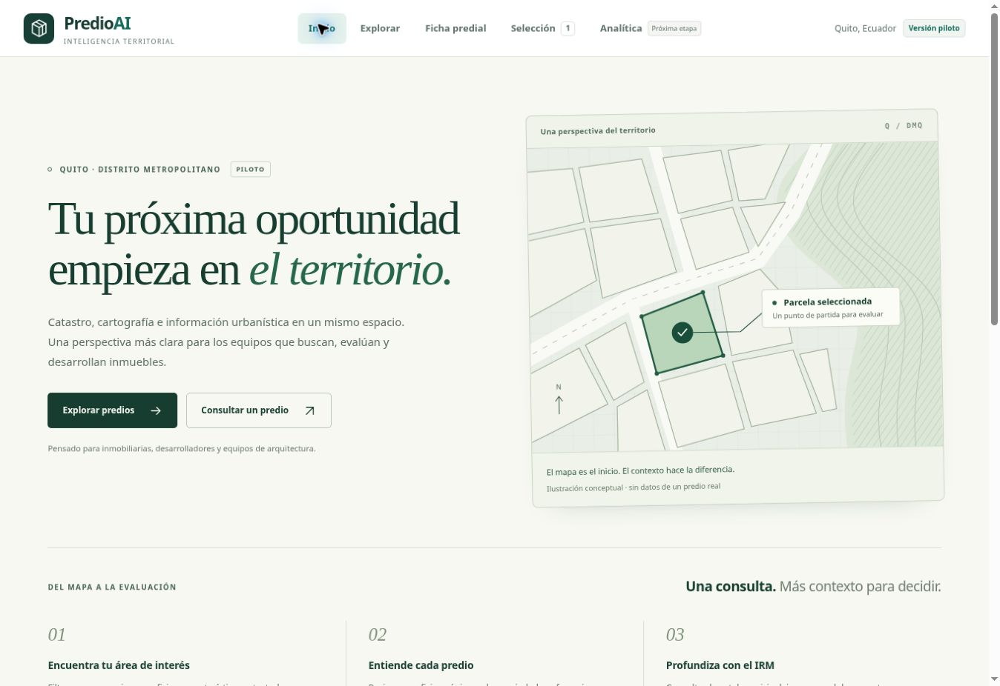

# PredioAI

**Territorial intelligence for real estate decisions in Quito.**

PredioAI brings municipal cadastral records, parcel mapping and urban-planning information into one workspace for real estate firms, developers and architecture teams. The current product helps users **discover parcels, understand their characteristics, compare a small selection and review the official IRM** before a more detailed professional evaluation.

The next product stage is an **explainable scoring engine and unsupervised segmentation**. These capabilities are being planned; the application does not yet generate scores, investment recommendations or model-derived rankings.

[Open the application](https://jayjayanton.github.io/Predio-AI/) · [Deployment guide](DEPLOYMENT.md)



## Product status and navigation

**Status: working pilot.** The interface is in Spanish and the initial geographic scope is Quito's Distrito Metropolitano. Municipal connectivity and document quality affect the evidence available for each property.

| Section | Purpose |
| --- | --- |
| **Inicio** | Product overview, current workflow and proposed pilot with an industry team |
| **Explorar** | Filter cadastral records, browse the map, select parcels and open their complete property sheet |
| **Ficha predial** | Look up a predio, inspect its cadastral information, consult the IRM and access the experimental project/document workflow |
| **Selección** | Compare up to four saved parcels and download their descriptive attributes as CSV |
| **Analítica** | Clearly labeled roadmap for future scoring and unsupervised segmentation; no active scores |

The central workflow is **explore → select → open the property sheet → review the IRM**. A parcel can also be queried directly by **número de predio** or **clave catastral**.

## What works today

### Geographic discovery

- Search by land-area range, cadastral urban/rural classification and multiple parishes, including a shortcut for the valleys.
- Add optional filters for minimum frontage, zonal administration, ownership regime and a single **maximum construction-to-land percentage from 0 to 100**. A blank percentage leaves that filter inactive. This ratio uses `area_const / area_terre`; it is not COS or building-footprint coverage.
- Apply the filters to the municipal ArcGIS query before counting and pagination. Administration and ownership choices come from published distinct field values.
- Browse compact results, sort by identifier or land area, and choose **50/100 records per page in Lista** or **100/200 in Iconos**.
- Select a result from its card or polygon, inspect its information and open **Ficha predial**. Map selection remains synchronized with the result list.
- Change the basemap between streets, OSM, topographic and satellite views. Nearby parcel outlines and source context remain available.

The map loads a bounded overlay of **up to 1,000 matching cadastral features**, independently of the current card page. An explicit message identifies partial coverage. The result count is the municipal query count, not a count of properties offered for sale.

### Property information and comparison

The property sheet shows cadastral identification, parish, land and construction areas, ownership regime and the valuation information returned by the service. It distinguishes an individual **propiedad horizontal (PH)** unit from its shared **lote matriz**. Cadastral valuations and zonal AIVA references are presented with their source context; they are not market appraisals.

**Selección** stores up to four descriptive property snapshots in the current browser's `localStorage`. Users can remove individual records, compare the same fields across parcels, reopen a property for a fresh lookup and download a UTF-8 CSV. PH attributed area is kept separate from the parent-lot area.

This is browser-local storage, not an account, shared team workspace or permanent project database. Uploaded documents and owner details are not included. When browser storage is unavailable, the selection remains in application memory for the active page session.

### Assisted IRM review

1. Open the selected property's IRM workflow.
2. Copy its predio number and open the official municipal portal.
3. Complete the municipal CAPTCHA manually and obtain the official PDF.
4. Select that PDF in PredioAI and review the extracted fields and document evidence.
5. Confirm the relevant values before using the available theoretical capacity calculations.

**The developer IRM workflow parses the PDF locally in the browser using PDF.js.** It does not upload this file to Render or call `/api/irm/extract`. The selected file, extracted fields and images are ephemeral application state: they are cleared on page reload or when the loaded property changes. Previous session-stored IRM extractions are not restored.

The browser parser accepts PDFs up to **15 MB / 100 pages**. It extracts recognizable text and document evidence as **unverified candidates**; a detected predio number that conflicts with the selected property is rejected. Scanned documents may need OCR, which is not implemented in this workflow.

The review includes available IRM/PUGS context, documented conditions and preliminary COS-based calculations after confirmation. A rectangular residential simulator is explicitly conceptual. These outputs do not authorize construction, establish permitted housing density or certify subdivision. PH calculations require particular care: the parent-lot area is never substituted for the unit's attributed cadastral area.

### Optional spatial zoning review

After cadastral discovery, users can request a preliminary PUGS review of the **current results page**. The frontend sends the already retrieved parcel geometries in batches of at most **100 per request**, including when the page contains 200 results.

`POST /api/pugs/spatial-screen` retrieves PUGS geometry by fixed geographic tiles, reuses a **15-minute process-local memory cache**, and intersects the polygons using a Shapely `STRtree` in **EPSG:32717**. Requests are geographically bounded; this is not a persistent whole-city zoning database.

The response distinguishes `single_zone`, `multiple_zones`, `no_intersection`, `unavailable` and `ambiguous`. Failed or incomplete upstream responses are not treated as negative eligibility decisions. VU/VB/VM labels are displayed only when explicit codes appear in the examined source fields; missing codes do not imply prohibition. The housing-evidence filter applies to the current page, not all of Quito.

### Experimental architectural document workspace

The project/document workflow remains available for PDF/DXF extraction and selectable geometry inspection. **This is separate from the browser-only developer IRM parser:** project documents are submitted to the FastAPI `/api/documents/analyze` endpoint and processed in memory.

The current workspace exposes extraction evidence and document geometry. Verified scale, architectural measurements and traceable exports remain later work. It does not automatically estimate materials, construction costs or regulatory compliance. See the [architectural methodology](docs/ARCHITECTURAL_ANALYSIS_METHODOLOGY.md) for the separate measurement-development direction.

## Next stage: analytics grounded in evidence

| Direction | Intended outcome | Current status |
| --- | --- | --- |
| Explainable scoring | Compare parcels under explicit project criteria, weights and constraints, with visible source quality and missing data | Planned |
| Unsupervised segmentation | Explore groups of parcels with similar observed characteristics and assess the usefulness and stability of those groups | Planned |
| Industry pilot | Define a real search case with a real estate team, review a parcel selection and evaluate the usefulness of the evidence | Proposed |
| Architectural measurements | Validate units, scale and selected PDF/CAD elements before deriving reviewable measurements | Separate later development |

The planned analytics must preserve the difference between observed data, calculated indicators and expert judgment. Similarity between parcels does not establish profitability; a future score must not conceal data gaps or substitute for due diligence.

## Design and UX

The interface uses a warm ivory workspace, forest/teal accents and a compact persistent navigation. The introductory illustration is explicitly conceptual rather than a representation of an actual cadastral record.

Implemented interaction improvements include:

- A clear route from a selected map result to its complete property sheet and IRM review.
- A four-parcel comparison selection with CSV export and browser-local persistence.
- Distinct primary and secondary actions, progressively disclosed filters and compact result rows.
- Clear loading, failure and empty-result messages, source labels and a visible boundary between current tools and planned analytics.
- Responsive layouts, accessible control labels, keyboard focus, comparison-table semantics and reduced-motion support.
- Parcel information on selection without the unwanted black rectangular map focus outline.

Run the frontend validation commands below before releasing interface changes. A passing build does not verify live municipal service availability.

## Architecture

| Layer | Implementation |
| --- | --- |
| Application | React 18, Vite, hash-based navigation |
| Maps | React Leaflet / Leaflet, municipal ArcGIS data, Esri and OpenStreetMap basemaps |
| Developer IRM parser | PDF.js in the browser; ephemeral file and extracted state |
| Comparison selection | Browser-local snapshots and client-side CSV export |
| API | Python / FastAPI / HTTPX |
| Spatial zoning | Shapely, pyproj, bounded PUGS tile retrieval and memory cache |
| Experimental PDF/DXF analysis | PyMuPDF and ezdxf on the backend |
| Hosting | GitHub Pages frontend + Render FastAPI backend |
| Optional desktop IRM assistant | Local Python bridge + Playwright / Chromium |

```text
frontend/       React application, browser IRM parsing, comparison and tests
backend/        FastAPI services, spatial/document analysis and tests
automation/     Optional local IRM desktop assistant
docs/           Methodology and product screenshots
.github/        Validation and GitHub Pages workflows
render.yaml     Existing Render backend configuration
```

## Run locally

**Requirements:** Node.js 20+ and Python 3.11+. Use the existing `main` branch of this repository.

In one terminal, start the backend:

```powershell
cd backend
python -m pip install -r requirements.txt
python -m uvicorn app.main:app --reload
```

API documentation: [http://localhost:8000/docs](http://localhost:8000/docs).

In a separate terminal, start the frontend:

```powershell
cd frontend
npm ci
npm run dev
```

Open [http://localhost:5173](http://localhost:5173). The frontend defaults to the local API; copy `frontend/.env.example` to `frontend/.env.local` if an override is needed. For a sample lookup, choose **Número de predio** and enter `627739`; the returned record depends on the live municipal service.

| Variable | Purpose | Default / production setting |
| --- | --- | --- |
| `VITE_API_URL` | Frontend API origin, read at build time | Local: `http://localhost:8000`; deployed: `https://predioai-api.onrender.com` |
| `CORS_ORIGINS` | Comma-separated permitted frontend origins | Local: `http://localhost:5173`; Render: `https://jayjayanton.github.io` |
| `QUITO_ARCGIS_URL` | Backend cadastral layer URL; a trailing `/query` is accepted | Municipal `predios_a_2024/FeatureServer/0` |

The explorer also queries the configured municipal ArcGIS service directly from the browser. Changing the backend's `QUITO_ARCGIS_URL` does not reconfigure the explorer's frontend source.

## API overview

| Method | Route | Purpose |
| --- | --- | --- |
| GET | `/api/health` | Backend health |
| GET | `/api/municipal/fields` | Published cadastral field metadata |
| GET | `/api/predios/{identifier_type}/{identifier}` | GeoJSON property lookup by `clave_cata` or `n_predio` |
| GET | `/api/property-details/{identifier_type}/{identifier}` | Structured property details |
| GET | `/api/predios/by-cadastral-key/{cadastral_key}` | Legacy cadastral-key lookup |
| GET | `/api/pugs/{identifier_type}/{identifier}` | Full-polygon PUGS query for one cadastral property |
| POST | `/api/pugs/spatial-screen` | Spatial screening of up to 100 supplied parcel polygons per request |
| POST | `/api/pugs/screen` | Compatibility endpoint for up to 20 predio identifiers; not used by the advanced explorer |
| POST | `/api/blueprints/inspect` | Basic PDF inspection: metadata and drawing/text counts |
| POST | `/api/documents/analyze` | Experimental project PDF/DXF and conditional IRM extraction |
| POST | `/api/irm/extract` | Backend IRM extraction endpoint; not used by the browser-based developer IRM workflow |

Document endpoints enforce a **15 MB per-file limit**. Basic PDF inspection also limits documents to **100 pages**. Document extraction returns evidence, not verified measurements, certification or completed reports.

## Validation and deployment

Frontend, from `frontend/`:

```powershell
npm ci
npm test
npm run build
```

Backend, from `backend/`:

```powershell
python -m pytest tests -q
```

Frontend tests cover selection normalization, persistence input validation and CSV export behavior. Backend tests cover API, document and spatial-processing behavior. Browser review should additionally check navigation, map/list selection, opening a property, comparison, responsive layouts and failed municipal requests.

The CI workflow runs backend tests and frontend tests/build. The Pages workflow tests and builds the frontend, then deploys on a push to **`main`** or manual dispatch. Its backend test job is separate; frontend publication is not proof that the API or upstream municipal services are healthy.

The production frontend uses Vite's `/Predio-AI/` base path. `VITE_API_URL` is baked into that build. The existing Render service uses `render.yaml`; GitHub Pages cannot run FastAPI. A sleeping backend can make the first lookup slower. See [DEPLOYMENT.md](DEPLOYMENT.md) for hosting configuration.

### Optional desktop IRM assistant

The manual portal workflow works without additional software. An experimental desktop option sends the selected predio number to a local bridge at `127.0.0.1:8765`, opens Chromium and waits for the user's CAPTCHA and report navigation. PDF import back into PredioAI remains manual.

For Windows, run `automation/setup_windows.bat` to install the local dependencies and configure the bridge. For a manual installation from the repository root:

```powershell
py -m pip install -r automation/requirements.txt
py -m playwright install chromium
py automation/irm_bridge.py
```

Playwright is an **optional desktop dependency**, not a requirement of the Render backend. Browser local-network permissions may affect the bridge. Refer to [automation/README.md](automation/README.md) for setup and operational limitations.

## Sources and interpretation

| Source | What it contributes | Interpretation |
| --- | --- | --- |
| [Quito cadastral attributes, 2024](https://geoquito.quito.gob.ec/server/rest/services/Hosted/predios_a_2024/FeatureServer/0) | Identification, areas, frontage, ownership, recorded use and cadastral valuations | Historical published attributes; not proof of current condition, availability or ownership due diligence |
| [Parcel geometry, February 2026](https://geoquito.quito.gob.ec/server/rest/services/Hosted/predios_2026_feb/FeatureServer/5) | Newer reference geometry where a valid match is available | A cadastral boundary, not a surveyed building footprint; original geometry is retained when needed |
| [Municipal AIVA service](https://geoquito.quito.gob.ec/server/rest/services/web_reference_dmc/valoracion_del_suelo/MapServer) | Zonal land reference values | Not transaction prices or a commercial property appraisal; point-based lookup has limits for parcels crossing zones |
| [Official IRM portal](https://pam.quito.gob.ec/mdmq_web_irm/irm/buscarPredio.jsf) | User-obtained official urban-planning document | Extracted fields need review; an IRM is not a construction permit |
| [PUGS 2024, layer 60](https://geoquito.quito.gob.ec/server/rest/services/web_reference_dmot/plan_de_uso_y_gestion_del_suelo_2024/MapServer/60) | Zoning and buildability evidence | Spatial intersections and explicit codes are preliminary; current rules, exceptions and the IRM require verification |

Additional methodological constraints:

- Administrative parish type, cadastral urban/rural classification and PUGS zoning are different concepts.
- PH attributed area (`area_ter_1`) and the parent lot (`area_terre`) must remain separate in comparisons and calculations.
- Deed and registration dates are not construction dates. Recorded construction area does not prove a permit or establish legality.
- Basic and maximum buildability are different; discrepancies between the IRM and PUGS are surfaced for review rather than silently reconciled.
- Missing data, failed requests and ambiguous intersections must remain visible. Absence of an explicit housing code is not a prohibition.
- Users need authorization to process architectural documents. Shared projects, authentication, durable document storage and access controls are not implemented.
- Source dates are distinct from consultation dates. Municipal-data and basemap reuse terms must be checked for the intended commercial use.

**PredioAI · Quito, Ecuador · Product pilot**
